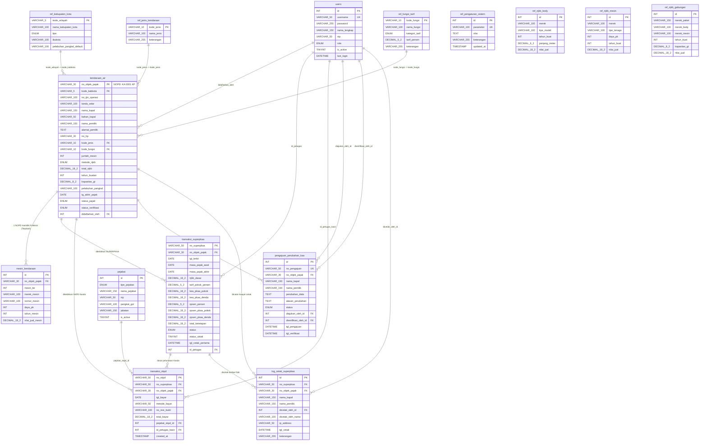

# Entity Relationship Diagram (ERD) & Kamus Data
## JANGKAR NTT &bull; Sistem Pajak Kendaraan di Atas Air (PKAA)
**Badan Pendapatan dan Aset Daerah (BPAD) Provinsi Nusa Tenggara Timur**

---

## 1. Ikhtisar Arsitektur Basis Data

Basis data **`db_pkaa`** dirancang menggunakan arsitektur relasional MySQL/MariaDB (InnoDB Engine) dengan pengkodean karakter `utf8mb4_unicode_ci`. Struktur basis data ini mengintegrasikan seluruh proses bisnis perpajakan daerah untuk Kendaraan Bermotor di Atas Air sesuai dengan amanat **Undang-Undang Nomor 1 Tahun 2022 (HKPD)** dan Peraturan Daerah Provinsi Nusa Tenggara Timur.

Basis data terdiri dari **15 entitas tabel** yang dikelompokkan ke dalam 4 domain utama:
1. **Domain Referensi & Wilayah**: Parameter sistem, daftar 22 Kabupaten/Kota di NTT, jenis kendaraan air, dan tarif fungsi.
2. **Domain Standar NJKB**: Nilai Jual Kendaraan Bermotor untuk Body/Lambung, Mesin, dan Paket Gabungan.
3. **Domain Objek Pajak**: Data induk kapal, wajib pajak, identitas selar, dan rincian mesin kapal.
4. **Domain Transaksi Fiskal & Audit**: Penerbitan SUPERPKAA, pembayaran & pengesahan SKPD Kasda (termasuk Opsen 66%), pengajuan mutasi/perubahan data, dan log audit cetak.

---

## 2. Diagram Visual ERD (Mermaid)

---

## 3. Kamus Data Lengkap (*Data Dictionary*)

### 3.1 Tabel `ref_kabupaten_kota`
Menyimpan referensi 22 wilayah administratif Kabupaten/Kota di Nusa Tenggara Timur dan kode wilayah resmi untuk penyusunan NOPD.
* **Primary Key**: `kode_wilayah`
* **Contoh Record**: `KP` (Kota Kupang), `MB` (Kab. Manggarai Barat / Labuan Bajo), `FL` (Kab. Flores Timur).

| Kolom | Tipe Data | Nullable | Keterangan |
| :--- | :--- | :---: | :--- |
| `kode_wilayah` | `VARCHAR(5)` | NO | Primary Key. Kode unik wilayah (contoh: KP, MB, KU, FL) |
| `nama_kabupaten_kota` | `VARCHAR(100)` | NO | Nama resmi Kabupaten/Kota di NTT |
| `tipe` | `ENUM('KOTA','KABUPATEN')` | NO | Jenis daerah administratif otonom |
| `ibukota` | `VARCHAR(100)` | NO | Nama kota pusat pemerintahan |
| `pelabuhan_pangkal_default` | `VARCHAR(100)` | NO | Pelabuhan pangkalan utama kapal di wilayah tersebut |

---

### 3.2 Tabel `ref_fungsi_tarif`
Menyimpan klasifikasi fungsi operasional kapal beserta tarif persentase resmi PKAA sesuai Perda Pajak Daerah NTT.
* **Primary Key**: `kode_fungsi`

| Kolom | Tipe Data | Nullable | Keterangan |
| :--- | :--- | :---: | :--- |
| `kode_fungsi` | `VARCHAR(10)` | NO | Primary Key (contoh: `F1`, `F2`, `F3`) |
| `nama_fungsi` | `VARCHAR(100)` | NO | Nama fungsi penggunaan (Angkutan Umum, Wisata, Pribadi) |
| `kategori_tarif` | `ENUM('ANGKUTAN_UMUM', 'PEMERINTAH', 'PRIBADI_BADAN')` | NO | Kelompok kategori pengenaan tarif |
| `tarif_persen` | `DECIMAL(5,2)` | NO | Tarif persentase pokok PKAA (contoh: `0.50` untuk 0,5%) |
| `keterangan` | `VARCHAR(255)` | YES | Catatan tambahan fungsi tarif |

---

### 3.3 Tabel `ref_jenis_kendaraan`
Klasifikasi jenis fisik kendaraan bermotor di atas air.
* **Primary Key**: `kode_jenis`

| Kolom | Tipe Data | Nullable | Keterangan |
| :--- | :--- | :---: | :--- |
| `kode_jenis` | `VARCHAR(10)` | NO | Primary Key (contoh: `J1`, `J2`, `J3`) |
| `nama_jenis` | `VARCHAR(100)` | NO | Nama tipe (Speedboat, Kapal Motor, Pinisi, Kapal Layar) |
| `keterangan` | `VARCHAR(255)` | YES | Deskripsi spesifikasi |

---

### 3.4 Tabel `users`
Akun operator, kasir, dan administrator penatausahaan pajak.
* **Primary Key**: `id`
* **Unique Key**: `username`

| Kolom | Tipe Data | Nullable | Keterangan |
| :--- | :--- | :---: | :--- |
| `id` | `INT AUTO_INCREMENT` | NO | Primary Key |
| `username` | `VARCHAR(50)` | NO | Username login unik |
| `password` | `VARCHAR(255)` | NO | Hash kata sandi (`password_hash` BCRYPT) |
| `nama_lengkap` | `VARCHAR(150)` | NO | Nama lengkap pejabat/petugas |
| `nip` | `VARCHAR(50)` | YES | NIP Pegawai Negeri Sipil / Petugas |
| `role` | `ENUM('ADMIN', 'OPERATOR', 'KASIR', 'KEPALA_UPT')` | NO | Tingkat hak akses otorisasi |
| `is_active` | `TINYINT(1)` | YES | Status keaktifan akun (1 = Aktif, 0 = Nonaktif) |
| `last_login` | `DATETIME` | YES | Waktu terakhir login pengguna |
| `created_at` | `TIMESTAMP` | YES | Waktu pendaftaran akun |

---

### 3.5 Tabel `pejabat`
Daftar pejabat berwenang penandatangan dokumen SKPD dan Laporan Rekapitulasi Kasda.
* **Primary Key**: `id`

| Kolom | Tipe Data | Nullable | Keterangan |
| :--- | :--- | :---: | :--- |
| `id` | `INT AUTO_INCREMENT` | NO | Primary Key |
| `tipe_pejabat` | `ENUM('SKPD', 'LAPORAN')` | NO | Klasifikasi penandatanganan dokumen |
| `nama_pejabat` | `VARCHAR(150)` | NO | Nama lengkap beserta gelar |
| `nip` | `VARCHAR(50)` | NO | NIP Pejabat Penandatangan |
| `pangkat_gol` | `VARCHAR(100)` | NO | Pangkat dan Golongan Ruang |
| `jabatan` | `VARCHAR(150)` | NO | Nama jabatan struktural resmi |
| `is_active` | `TINYINT(1)` | YES | Status aktif penandatangan (1 = Aktif) |

---

### 3.6 Tabel `kendaraan_air` (Tabel Induk Objek Pajak)
Tabel master yang menyimpan seluruh identitas teknis, legalitas, pemilik, metode NJKB, dan masa berlaku pajak kapal.
* **Primary Key**: `no_objek_pajak` (Format NOPD: `KA 0001 KP`)
* **Foreign Keys**:
  - `kode_kabkota` $\rightarrow$ `ref_kabupaten_kota.kode_wilayah`
  - `kode_jenis` $\rightarrow$ `ref_jenis_kendaraan.kode_jenis`
  - `kode_fungsi` $\rightarrow$ `ref_fungsi_tarif.kode_fungsi`
  - `didaftarkan_oleh` $\rightarrow$ `users.id`

| Kolom | Tipe Data | Nullable | Keterangan |
| :--- | :--- | :---: | :--- |
| `no_objek_pajak` | `VARCHAR(30)` | NO | Primary Key. Format 3 kotak: KA [No. Urut] [Kode Wilayah] |
| `kode_kabkota` | `VARCHAR(5)` | NO | Kode Kabupaten/Kota asal registrasi |
| `no_ijin_operasi` | `VARCHAR(100)` | YES | Nomor Surat Izin Trayek / Operasi dari Dishub |
| `tanda_selar` | `VARCHAR(100)` | YES | Tanda Selar resmi (contoh: GT.15 No.210/IIk) |
| `nama_kapal` | `VARCHAR(150)` | NO | Nama kapal / Speedboat |
| `bahan_kapal` | `VARCHAR(50)` | NO | Bahan lambung (KAYU, FIBER, BESI/BAJA, ALUMINIUM) |
| `nama_pemilik` | `VARCHAR(150)` | NO | Nama pemilik perorangan atau badan hukum |
| `alamat_pemilik` | `TEXT` | NO | Alamat domisili lengkap wajib pajak |
| `no_hp` | `VARCHAR(30)` | YES | Kontak telepon / WhatsApp wajib pajak |
| `kode_jenis` | `VARCHAR(10)` | NO | Referensi jenis kendaraan air |
| `kode_fungsi` | `VARCHAR(10)` | NO | Referensi fungsi penggunaan kapal |
| `jumlah_mesin` | `INT` | NO | Jumlah mesin penggerak terpasang |
| `metode_njkb` | `ENUM('TERPISAH', 'GABUNGAN')` | NO | Metode penilaian fiskal NJKB |
| `nj_body_kapal` | `DECIMAL(18,2)` | NO | Nilai jual lambung/body (metode TERPISAH) |
| `total_njkb_mesin` | `DECIMAL(18,2)` | NO | Akumulasi nilai jual seluruh mesin (metode TERPISAH) |
| `njkb_gabungan` | `DECIMAL(18,2)` | NO | Nilai jual total 1 kesatuan (metode GABUNGAN) |
| `total_njkb` | `DECIMAL(18,2)` | NO | Total Dasar Pengenaan NJKB (Body + Mesin / Gabungan) |
| `tahun_buatan` | `INT` | NO | Tahun perakitan / pembuatan kapal |
| `kapasitas_gt` | `DECIMAL(8,2)` | NO | Tonase kotor kapal (Gross Tonnage) |
| `pelabuhan_pangkal` | `VARCHAR(100)` | NO | Nama pelabuhan pangkalan tempat kapal bersandar |
| `tg_akhir_pajak` | `DATE` | NO | Tanggal batas akhir masa berlaku ketetapan pajak |
| `status_pajak` | `ENUM('TERDAFTAR', 'TERBIT_SUPER', 'LUNAS', 'JATUH_TEMPO')` | YES | Siklus status fiskal kapal |
| `status_verifikasi` | `ENUM('VERIFIKASI', 'MENUNGGU_VERIFIKASI')` | YES | Status validasi data oleh Admin Induk |
| `didaftarkan_oleh` | `INT` | YES | ID User operator yang mendaftarkan |
| `status_aktif` | `TINYINT(1)` | YES | Status aktif objek (1 = Aktif, 0 = Hapus/Scrap) |

---

### 3.7 Tabel `mesin_kendaraan`
Rincian setiap unit mesin penggerak pada kapal yang menggunakan metode penetapan NJKB TERPISAH.
* **Primary Key**: `id`
* **Foreign Key**: `no_objek_pajak` $\rightarrow$ `kendaraan_air.no_objek_pajak` (`ON DELETE CASCADE`)

| Kolom | Tipe Data | Nullable | Keterangan |
| :--- | :--- | :---: | :--- |
| `id` | `INT AUTO_INCREMENT` | NO | Primary Key |
| `no_objek_pajak` | `VARCHAR(30)` | NO | NOPD kapal induk pemilik mesin |
| `mesin_ke` | `INT` | NO | Nomor urut mesin (Mesin Ke-1, Ke-2, dst.) |
| `merek_mesin` | `VARCHAR(100)` | NO | Merek mesin (YAMAHA, SUZUKI, HONDA, MITSUBISHI, YANMAR) |
| `nomor_mesin` | `VARCHAR(100)` | YES | Nomor seri mesin fisik |
| `daya_pk` | `INT` | YES | Besaran daya mesin dalam satuan Horsepower / PK |
| `tahun_mesin` | `INT` | NO | Tahun pembuatan mesin |
| `nilai_jual_mesin` | `DECIMAL(18,2)` | NO | Nilai jual standar hasil perhitungan tabel NJKB |

---

### 3.8 Tabel `transaksi_superpkaa` (Surat Pemberitahuan Pajak KAA)
Dokumen surat penetapan resmi besaran kewajiban pajak PKAA sebelum dilakukan pembayaran.
* **Primary Key**: `no_superpkaa`
* **Foreign Keys**:
  - `no_objek_pajak` $\rightarrow$ `kendaraan_air.no_objek_pajak`
  - `id_petugas` $\rightarrow$ `users.id`

| Kolom | Tipe Data | Nullable | Keterangan |
| :--- | :--- | :---: | :--- |
| `no_superpkaa` | `VARCHAR(50)` | NO | Primary Key. Format: `SUPER/PKAA/YYYY/MM/XXXX` |
| `no_objek_pajak` | `VARCHAR(30)` | NO | NOPD kapal yang dikenakan pajak |
| `tgl_terbit` | `DATE` | NO | Tanggal penetapan dokumen SUPERPKAA |
| `masa_pajak_awal` | `DATE` | NO | Tanggal dimulainya tahun pajak baru |
| `masa_pajak_akhir` | `DATE` | NO | Tanggal berakhirnya tahun pajak (+1 tahun) |
| `njkb_dasar` | `DECIMAL(18,2)` | NO | Nilai Jual Kendaraan Bermotor sebagai dasar hitung |
| `tarif_pokok_persen` | `DECIMAL(5,2)` | NO | Tarif persentase pokok PKAA |
| `bea_pkaa_pokok` | `DECIMAL(18,2)` | NO | Bea Pokok PKAA (NJKB &times; Tarif Pokok) |
| `bea_pkaa_denda` | `DECIMAL(18,2)` | NO | Sanksi denda administrasi keterlambatan pokok |
| `opsen_persen` | `DECIMAL(5,2)` | NO | Tarif Opsen PKAA (66% sesuai UU HKPD) |
| `opsen_pkaa_pokok` | `DECIMAL(18,2)` | NO | Nilai Opsen Pokok (66% dari Bea Pokok) |
| `opsen_pkaa_denda` | `DECIMAL(18,2)` | NO | Nilai Denda Opsen (66% dari Bea Denda) |
| `total_ketetapan` | `DECIMAL(18,2)` | NO | Total kewajiban pembayaran (Pokok + Opsen + Denda) |
| `status` | `ENUM('TERBIT', 'LUNAS', 'BATAL')` | YES | Status dokumen ketetapan |
| `status_cetak` | `TINYINT(1)` | YES | Syarat alur: 0 = Belum Dicetak, 1 = Sudah Dicetak |
| `tgl_cetak_pertama` | `DATETIME` | YES | Waktu pertama kali lembar fisik dicetak oleh petugas |
| `id_petugas` | `INT` | NO | ID Petugas loket yang menerbitkan ketetapan |

---

### 3.9 Tabel `transaksi_skpd` (Surat Ketetapan Pajak Daerah & Pelunasan Kasda)
Dokumen sah tanda pelunasan kas daerah dan ketetapan hukum pembayaran pajak PKAA.
* **Primary Key**: `no_skpd`
* **Foreign Keys**:
  - `no_superpkaa` $\rightarrow$ `transaksi_superpkaa.no_superpkaa`
  - `no_objek_pajak` $\rightarrow$ `kendaraan_air.no_objek_pajak`
  - `pejabat_skpd_id` $\rightarrow$ `pejabat.id`
  - `id_petugas_kasir` $\rightarrow$ `users.id`

| Kolom | Tipe Data | Nullable | Keterangan |
| :--- | :--- | :---: | :--- |
| `no_skpd` | `VARCHAR(50)` | NO | Primary Key. Format: `SKPD/PKAA/YYYY/XXXXXX` |
| `no_superpkaa` | `VARCHAR(50)` | NO | Nomor SUPERPKAA rujukan ketetapan |
| `no_objek_pajak` | `VARCHAR(30)` | NO | NOPD kapal yang dilunasi |
| `tgl_bayar` | `DATE` | NO | Tanggal pelunasan kasda |
| `metode_bayar` | `VARCHAR(50)` | NO | Kanal pembayaran (BANK NTT, TUNAI, QRIS, TRANSFER) |
| `no_resi_bukti` | `VARCHAR(100)` | YES | Nomor Resi Kasda / Bukti Setor Bank / NTPN |
| `bea_pkaa_pokok_bayar` | `DECIMAL(18,2)` | NO | Realisasi pelunasan Bea Pokok PKAA (Kas Prov. NTT) |
| `bea_pkaa_denda_bayar` | `DECIMAL(18,2)` | NO | Realisasi denda pokok PKAA |
| `opsen_pkaa_pokok_bayar`| `DECIMAL(18,2)` | NO | Realisasi Opsen Pokok (Kas Kab/Kota terkait) |
| `opsen_pkaa_denda_bayar`| `DECIMAL(18,2)` | NO | Realisasi denda Opsen |
| `total_bayar` | `DECIMAL(18,2)` | NO | Total nominal uang yang disetorkan ke Kasda |
| `pejabat_skpd_id` | `INT` | NO | ID Pejabat yang mengesahkan SKPD |
| `id_petugas_kasir` | `INT` | NO | ID Petugas kasir penerima setoran |
| `created_at` | `TIMESTAMP` | YES | Timestamp penerbitan SKPD |

---

### 3.10 Tabel `pengajuan_perubahan_kaa`
Mekanisme pengajuan perubahan atau mutasi data kapal (nama pemilik, pelabuhan pangkal, tanda selar) yang diajukan oleh Operator dan wajib disetujui oleh Admin Induk BPAD NTT.
* **Primary Key**: `id`
* **Unique Key**: `no_pengajuan`

| Kolom | Tipe Data | Nullable | Keterangan |
| :--- | :--- | :---: | :--- |
| `id` | `INT AUTO_INCREMENT` | NO | Primary Key |
| `no_pengajuan` | `VARCHAR(50)` | NO | Nomor registrasi pengajuan (`PGB/KAA/YYYY/MM/XXXX`) |
| `no_objek_pajak` | `VARCHAR(30)` | NO | NOPD kapal yang diajukan perubahan |
| `nama_kapal` | `VARCHAR(150)` | NO | Nama kapal saat pengajuan |
| `nama_pemilik` | `VARCHAR(150)` | NO | Nama pemilik saat pengajuan |
| `perubahan_data` | `TEXT` | NO | Data diff JSON perbandingan nilai lama dan nilai baru |
| `alasan_perubahan` | `TEXT` | NO | Alasan mutasi / balik nama / perubahan tanda selar |
| `lampiran_dokumen` | `VARCHAR(255)` | YES | Nomor surat pengantar / scan berkas pendukung |
| `status` | `ENUM('MENUNGGU_VERIFIKASI', 'DISETUJUI', 'DITOLAK')` | YES | Status persetujuan Admin Induk |
| `diajukan_oleh_id` | `INT` | NO | ID Operator pemohon perubahan |
| `diajukan_oleh_nama` | `VARCHAR(100)` | NO | Nama lengkap Operator pemohon |
| `diverifikasi_oleh_id` | `INT` | YES | ID Admin Induk yang melakukan approval |
| `catatan_verifikasi` | `TEXT` | YES | Catatan atau alasan persetujuan/penolakan |
| `tgl_pengajuan` | `DATETIME` | YES | Waktu pengajuan diajukan |
| `tgl_verifikasi` | `DATETIME` | YES | Waktu pengajuan diproses verifikasi |

---

### 3.11 Tabel `log_cetak_superpkaa`
Buku ekspedisi elektronik yang mencatat riwayat setiap pencetakan fisik lembar SUPERPKAA untuk mencegah pencetakan liar tanpa penatausahaan resmi.
* **Primary Key**: `id`

| Kolom | Tipe Data | Nullable | Keterangan |
| :--- | :--- | :---: | :--- |
| `id` | `INT AUTO_INCREMENT` | NO | Primary Key |
| `no_superpkaa` | `VARCHAR(50)` | NO | Nomor SUPERPKAA yang dicetak |
| `no_objek_pajak` | `VARCHAR(30)` | NO | NOPD kapal terkait |
| `nama_kapal` | `VARCHAR(150)` | NO | Nama kapal |
| `nama_pemilik` | `VARCHAR(150)` | NO | Nama pemilik kapal |
| `dicetak_oleh_id` | `INT` | NO | ID Petugas yang mencetak dokumen |
| `dicetak_oleh_nama` | `VARCHAR(100)` | NO | Nama lengkap petugas pencetak |
| `ip_address` | `VARCHAR(50)` | YES | Alamat IP komputer petugas loket pencetak |
| `tgl_cetak` | `DATETIME` | YES | Waktu pencetakan dieksekusi |
| `keterangan` | `VARCHAR(255)` | YES | Keterangan aksi (Cetak Pertama / Cetak Ulang) |

---

### 3.12 Tabel Referensi Benchmark NJKB (`ref_njkb_body`, `ref_njkb_mesin`, `ref_njkb_gabungan`)
Standar nilai pasar wajar yang diterbitkan oleh Pemerintah Daerah sebagai pedoman dasar pengenaan pajak PKAA.
* **`ref_njkb_body`**: Indeks nilai body per merek lambung, tipe, dan tahun pembuatan.
* **`ref_njkb_mesin`**: Indeks nilai mesin penggerak per merek mesin, daya PK, dan tahun pembuatan.
* **`ref_njkb_gabungan`**: Indeks nilai paket gabungan utuh (lambung + mesin sekaligus) per merek paket dan tahun pembuatan.

---

## 4. Alur Bisnis & Siklus Hidup Objek (*Lifecycle*)

1. **Tahap 1: Pendaftaran Baru (`status_pajak = 'TERDAFTAR'`)**
   Operator menginput identitas fisik kapal, pemilik, pelabuhan pangkal, dan komponen NJKB. Sistem secara otomatis men-generate NOPD baru dengan format standar 3 kotak:
   $$\text{KA}\quad [0001]\quad [\text{KP}]$$
2. **Tahap 2: Penetapan SUPERPKAA (`status_pajak = 'TERBIT_SUPER'`)**
   Sistem menghitung tarif pokok PKAA, denda keterlambatan (jika ada), dan Opsen 66%. Diterbitkan lembar SUPERPKAA dengan `status_cetak = 0`.
3. **Tahap 3: Syarat Cetak Lembar SUPERPKAA (`status_cetak = 1`)**
   Sebelum SKPD dapat diproses, lembar fisik SUPERPKAA wajib dicetak di loket. Sistem mencatat log cetak audit pada `log_cetak_superpkaa`.
4. **Tahap 4: Pelunasan Kasda & SKPD (`status_pajak = 'LUNAS'`)**
   Kasir/Operator memproses setoran kas daerah melalui Bank NTT / QRIS / Tunai. Diterbitkan SKPD Sah 3 rangkap, masa berlaku pajak kapal diperpanjang $+1$ tahun, dan status SUPERPKAA ditandai `LUNAS`.
5. **Tahap 5: Daftar Ulang / Pembayaran Tahunan**
   Setelah masa berlaku 1 tahun habis (`status_pajak = 'JATUH_TEMPO'`), wajib pajak melakukan pendaftaran ulang tahunan di menu Pembayaran PKAA Tahunan tanpa perlu mendaftarkan ulang nomor objek pajak (NOPD tetap sama selamanya).
